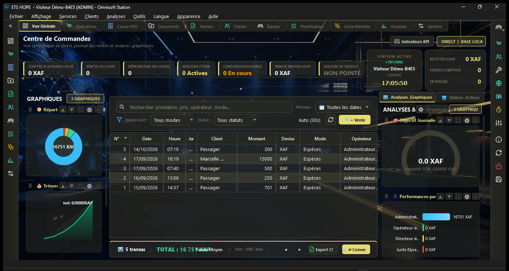
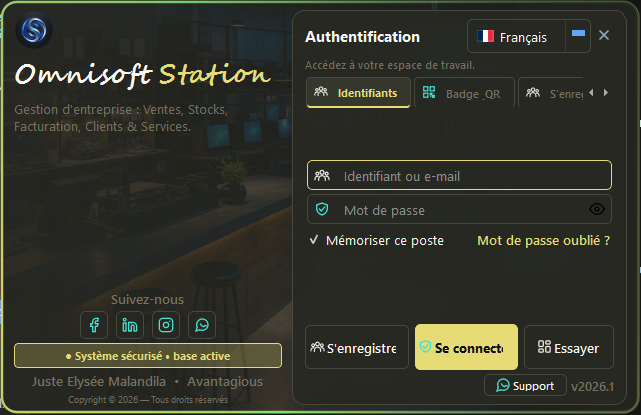
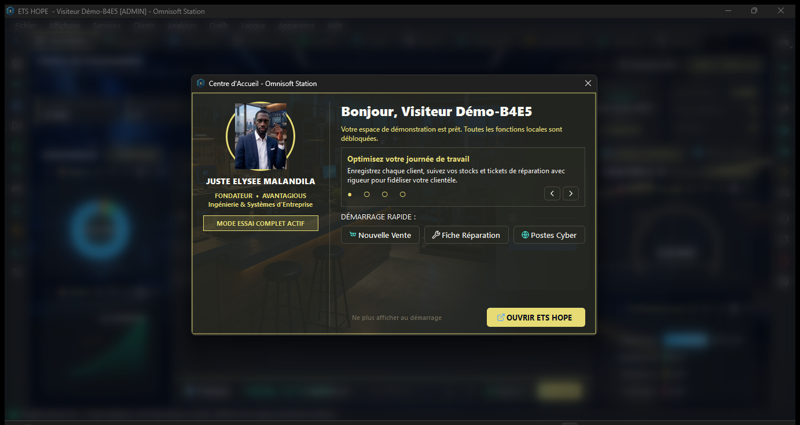

# Omnisoft Station 🖥

**Suite de gestion d'entreprise native — C++ / Qt Widgets.**
~28 300 lignes C++ — ventes, stocks, facturation, réparations,
postes cyber, clients & services.

> Développé intégralement par **Juste Elysée MALANDILA** — Brazzaville, Congo.
> 📫 malandilajusteelysee@gmail.com · linkedin.com/in/justelm · yusticanum.com

---

## 🇫🇷 Présentation

Omnisoft Station est un logiciel de gestion d'entreprise tout-en-un :
ventes au comptoir, stocks, facturation, fiches de réparation,
sessions cyber, clients et personnel — pensé pour les commerces,
ateliers et cybercafés (monnaie XAF, démo « ETS HOPE » embarquée).

### Modules métier

- **Centre de Commandes** — KPIs live (CA du jour, ventes, réparations
  en cours, sessions cyber, consignes recharge, panier moyen),
  journal des transactions filtrable, trésorerie, objectif journalier,
  performances par opérateur
- **Caisse POS** — encaissements multi-modes (espèces…), export CSV
- **Opérations** — ventes, réparations, sessions cyber actives
- **Documents & Tableur** — facturation, documents internes, tableur
  natif (`OmniSheet`)
- **Clients & Équipe** — fiches clients, opérateurs, rôles
  (ADMIN/opérateur/directeur), pointage de sessions
- **Planification & Carte Mentale** — planning et mind maps intégrés
- **Analyses** — graphiques métier, indicateurs KPI, widgets custom

### Plateforme

- **Authentification** par identifiants, **badge QR** ou inscription ;
  mode **Essai** avec espace démo complet (Visiteur Démo, tous les
  modules débloqués)
- **Centre d'accueil** au démarrage : actions rapides (Nouvelle Vente,
  Fiche Réparation, Postes Cyber), carte fondateur
- **Multi-langue + thèmes** — `LanguageManager`, `AppearanceManager`
- **Téléphonie & modem** GSM (`ModemManager`), chat interne,
  QR codes, enregistrement vocal, base de données embarquée
- Station « en ligne » avec horloge, station actions, base locale

### Engineering

| Aspect | Détail |
|---|---|
| Volume | ~28 300 lignes C++ — widgets Qt natifs sur mesure |
| UI | Qt Widgets + QSS, pages modulaires (Dashboard/Pages/Dialogs) |
| Build | CMake + MSVC, scripts de build natif |

## � Galerie

| Connexion entreprise | Centre d'accueil démo |
|---|---|
|  |  |

## �📥 Démo

Exécutable Windows en préparation —
[Releases](https://github.com/jdevseer9/Omnisoft-Station/releases).
Code source **non public** — disponible sur demande.
