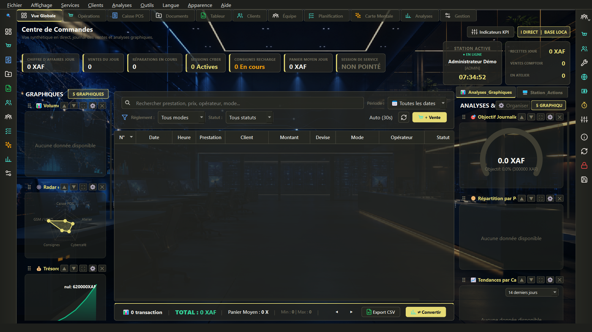

# Omnisoft Station 🖥

**All-in-one native desktop station — C++ / Qt Widgets.**
~28 300 lignes C++ — téléphonie, cartes mentales, tableurs,
enregistrement vocal, QR codes.

> Développé intégralement par **Juste Elysée MALANDILA** — Brazzaville, Congo.
> 📫 malandilajusteelysee@gmail.com · linkedin.com/in/justelm · yusticanum.com

---

## 🇫🇷 Présentation

Omnisoft Station est une station de travail de bureau complète,
entièrement native C++/Qt — un concentré d'outils métiers dans une
seule application : dashboard, communication, données, documents.

### Modules

- **Dashboard** — vue d'ensemble, indicateurs, widgets graphiques
  custom (`OmniChartWidget`)
- **Téléphonie & modem** — gestion modem (`ModemManager`), widget
  téléphonie complet (appels via modem GSM)
- **Mind maps** — widget de cartes mentales interactif
- **Tableur intégré** — `OmniSheet`, vue table native (`OmniTableView`)
- **Chat** — messagerie interne (`OmniChatWidget`)
- **QR codes** — génération (`OmniQrCode`)
- **Enregistrement vocal** — dictaphone intégré
- **Base de données** — couche `Database` embarquée
- **Multi-langue + thèmes** — `LanguageManager`, `AppearanceManager`,
  sélecteur de couleurs custom, splash + assistant de bienvenue

### Engineering

| Aspect | Détail |
|---|---|
| Volume | ~28 300 lignes C++ — widgets Qt natifs sur mesure |
| UI | Qt Widgets + QSS, pages modulaires (Dashboard/Pages/Dialogs) |
| Build | CMake + MSVC, scripts de build natif |

## 📥 Démo

Exécutable Windows en préparation —
[Releases](https://github.com/jdevseer9/Omnisoft-Station/releases).
Code source **non public** — disponible sur demande.
